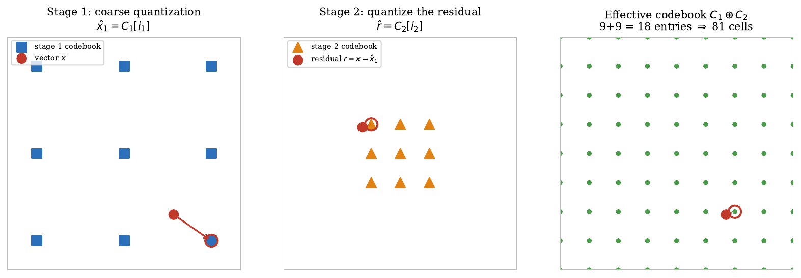
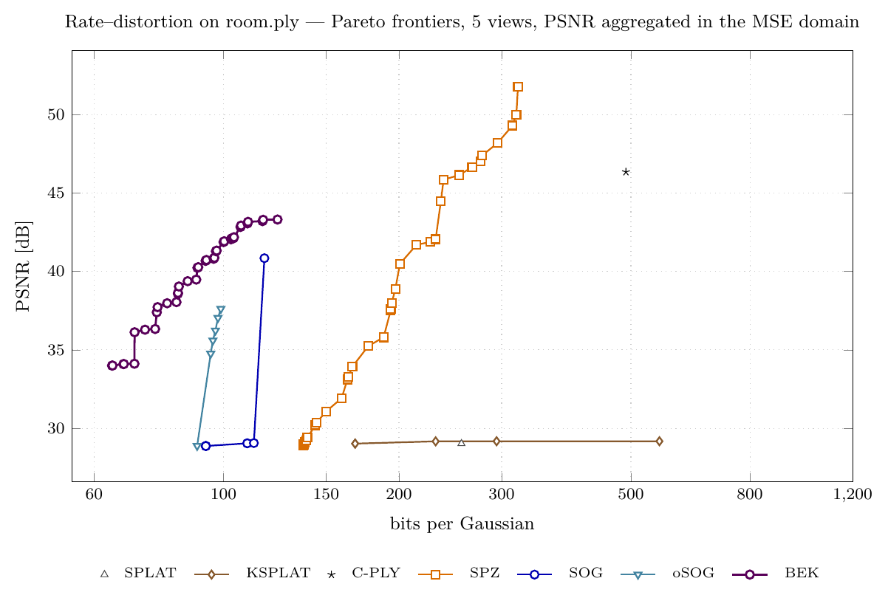
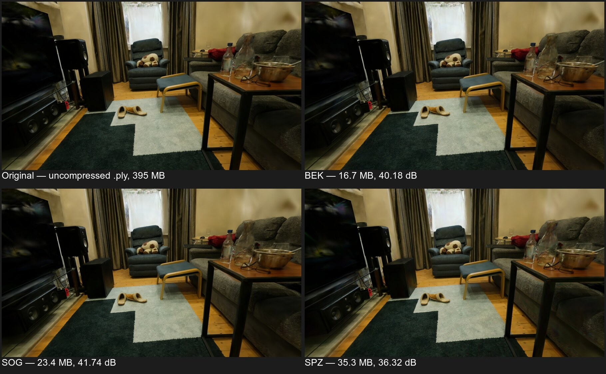

# BEK — 3D Gaussian Splatting Compression

**BEK 3.67** is a C++17 lossy codec for 3D Gaussian Splatting models. It provides
two command-line applications:

- **`ply_to_bek`** compresses a Gaussian Splatting `.ply` scene into a `.bek` file.
- **`bek_to_ply`** reconstructs a `.ply` scene from a `.bek` file.

The default pipeline preserves the number of Gaussians: it quantizes their
attributes without pruning or selecting Gaussians by opacity or visibility.
Spatial ordering changes the order of the Gaussians in the reconstructed PLY.
Compression is lossy, so the reconstructed attributes generally differ from the
original values.

## Build

The current build targets macOS and Linux with a GCC- or Clang-compatible compiler.
Requirements:

- A C++17 compiler.
- CMake 3.14 or newer.
- Git and internet access for the first CMake configuration.
- The WebP development library installed on the system.

Install WebP on macOS with Homebrew:

```bash
brew install webp
```

On Debian or Ubuntu:

```bash
sudo apt-get install libwebp-dev
```

From the repository root:

```bash
cmake -S . -B build
cmake --build build -j
```

CMake fetches **Zstd 1.5.5** and **nlohmann/json 3.11.2** from their Git
repositories into `build/_deps/`. Zstd is built as a static library;
nlohmann/json is header-only. WebP is located on the system.
PLY input and output use [tinyply 2.3.4](https://github.com/ddiakopoulos/tinyply),
by Dimitri Diakopoulos, included in `src/`.
The build produces `build/ply_to_bek` and `build/bek_to_ply`.

`BEK_FAST_MATH` defaults to `OFF`, using `-fno-fast-math -ffp-contract=off`.

The current build uses `-march=native`, so binaries are optimized for the build
machine's CPU and may not run on a different CPU.

## Tests

Small synthetic PLY fixtures exercise the complete encode/decode chain, including
ASCII and binary input, coincident positions and selected encoder options. Tests
check Gaussian count, finite attributes and reconstruction error, allowing for
spatial reordering and lossy quantization. They require Python 3 (standard library
only), with no renderer or external scenes.

```bash
cmake -S . -B build -DBUILD_TESTING=ON
cmake --build build -j
ctest --test-dir build --output-on-failure
```

Tests are disabled by default and do not affect installation.

## Installation

After building, install the codec with:

```bash
sudo cmake --install build --prefix /usr/local
```

The executables are installed in `/usr/local/bin` and documentation in
`/usr/local/share/doc/gs_encodingc`.

## Usage

Encode with the default parameters:

```bash
./build/ply_to_bek input.ply output.bek
```

Decode:

```bash
./build/bek_to_ply output.bek reconstructed.ply
```

### Try the included PLY scene

The repository includes a small binary PLY with 32 synthetic Gaussians.
From the repository root, encode and reconstruct it with:

```bash
./build/ply_to_bek tests/data/cloud_binary.ply build/cloud.bek
./build/bek_to_ply build/cloud.bek build/cloud_reconstructed.ply
```

Open `tests/data/cloud_binary.ply` and `build/cloud_reconstructed.ply` separately
in a browser viewer to inspect the original and reconstructed scenes:

- [Mark Kellogg's Gaussian Splats 3D viewer](https://projects.markkellogg.org/threejs/demo_gaussian_splats_3d.php):
  use **View a .ply, .ksplat, or .splat file**, choose the PLY and click **View**.
- [Kevin Kwok's WebGL Gaussian Splat Viewer](https://antimatter15.com/splat/):
  drag and drop the PLY onto the page.

These viewers open the decoded `.ply`, rather than the `.bek` container. The
included scene is a small test pattern; adjust the camera and zoom to inspect it.
The same encode/decode commands apply to your own Gaussian Splatting PLY scenes.

### Encoder parameters

Options follow the input and output paths:

```bash
./build/ply_to_bek input.ply output.bek \
    --dc-stages 2 --sh-stages 3 --pos-bits 9 --vq-iters 30
```

| Option | Default | Description |
|---|---|---|
| `--dc-stages N` | `2` | Residual vector quantization (RVQ) stages for SH DC coefficients. |
| `--sh-stages N` | `3` | Joint RVQ stages for the 45 SH AC coefficients. |
| `--vq-iters N` | `30` | Maximum k-means training iterations per VQ stage. |
| `--pos-bits N` | `9` | Fractional bits for fixed-point positions. |
| `--rot-mag-bits N` | `6` | Quaternion component magnitude bits, clamped to 2–6. |
| `--scale-bits N` | `8` | Scalar scale quantization bits, clamped to 1–8; used when scale RVQ is disabled. |
| `--scale-stages N` | `0` | Scale RVQ stages; `0` selects scalar min–max quantization. |
| `--sort-refine N` | `128` | Window size for 2-opt refinement after spatial ordering; `0` disables refinement. |
| `--no-rvq-cb-order` | Off | Disable the default nearest-neighbour relabelling of RVQ codebooks. |

More RVQ stages generally increase both size and reconstruction fidelity.
More position fractional bits increase positional precision within the 24-bit
fixed-point representation. The decoder obtains reconstruction parameters from
the file and needs no matching quality options.

The encoder also retains experimental and compatibility options in
[`apps/ply_to_bek.cpp`](apps/ply_to_bek.cpp), including alternative quantizers,
ordering methods and attribute omission. The defaults above describe the normal
codec pipeline.

### Input format

Input files use the Gaussian Splatting PLY attribute layout, with float32 vertex
properties:

- Positions: `x`, `y`, `z`.
- Opacity: `opacity` (logit representation).
- Scales: `scale_0` through `scale_2` (log representation).
- Quaternion rotation: `rot_0` through `rot_3`.
- SH DC coefficients: `f_dc_0` through `f_dc_2`.
- SH AC coefficients: `f_rest_0` through `f_rest_44` for degree-3 SH.

## Compression pipeline

1. Load Gaussian attributes from PLY.
2. Reorder Gaussians using Morton order and windowed 2-opt refinement.
3. Quantize positions with fixed-point zigzag DPCM, opacity with sigmoid-to-u8,
   rotations with smallest-three packing, scales with scalar min–max
   quantization, and SH coefficients with RVQ.
4. For each channel, select the smallest payload among lossless WebP, adaptive
   range coders, specialized position or rotation coders where applicable, and
   raw bytes.
5. Serialize channel metadata as CBOR and wrap the header and payloads in Zstd.

Entropy coding is lossless with respect to the quantized attributes.

The figure below illustrates RVQ with two stages. The first codebook provides a
coarse approximation of the input vector; the second quantizes the remaining
residual. The decoder adds the two selected codewords. In this example, two
9-entry codebooks provide 81 possible sums while storing only 18 codewords.
BEK applies the same principle to SH coefficients, using up to 256 codewords per
stage and one index byte per Gaussian per stage, before entropy coding.



See [`docs/compression.md`](docs/compression.md) for container and channel details.
The encoder parameter defaults in this README reflect the current source code;
the format document also contains historical and experimental material.

## Results

Rate–distortion frontiers on `room.ply` (1.59 million Gaussians), evaluated over
five fixed views with PSNR aggregated in the MSE domain:



| Codec | Rate (bpg) | PSNR (dB) |
|---|---:|---:|
| BEK (frontier) | 64.4–123.8 | 34.0–43.3 |
| BEK (at SOG PSNR) | 93 | 40.8 |
| BEK (at SPZ PSNR) | 64.4 | 34.0 |
| SOG (PlayCanvas) | 117.6 | 40.8 |
| SPZ v4 (Niantic) | 169.9 | 34.0 |

The same scene rendered from the original PLY and the BEK, SOG and SPZ containers.
Sizes and PSNR shown in this image refer to the illustrated evaluation view:



## Repository layout

| Path | Contents |
|---|---|
| `apps/` | Encoder and decoder command-line entry points. |
| `src/` | Shared implementation and internal headers: PLY I/O, ordering, quantization, RVQ and entropy coders. |
| `CMake/` | Configuration header template; CMake generates `build/config.h`. |
| `tests/` | Synthetic PLY fixtures and end-to-end codec checks. |
| `docs/compression.md` | BEK container and channel documentation. |
| `assets/` | Illustrations and comparison images. |

## Browser implementation

A separate TypeScript implementation is available as
[BEK Online Coder](https://sebastianobecchetti.github.io/bek_online_coder/)
([source repository](https://github.com/sebastianobecchetti/bek_online_coder)).

## Citation

If you use this codec in your projects or scientific works, please cite our arXiv paper:

```bibtex
@misc{becchetti2026,
  author = {Becchetti, Sebastiano and Baruffa, Giuseppe and Frescura, Fabrizio},
  title = {A Binary Entropic Lossy Coder for {3D} Gaussian Splatting Models},
  year = {2026},
  archivePrefix = {arXiv},
  url = {ARXIV_URL_TO_BE_ADDED}
}
```

See [`CITATION.cff`](CITATION.cff) for the software citation metadata.

## License

[MIT](LICENSE). Third-party dependencies retain their respective licenses.

## References

[1] B. Kerbl, G. Kopanas, T. Leimkuehler, and G. Drettakis, “3D Gaussian Splatting for Real-Time Radiance Field Rendering,” *ACM Trans. Graph.*, vol. 42, no. 4, Art. no. 139, pp. 1–14, Jul. 2023, doi: [10.1145/3592433](https://doi.org/10.1145/3592433).

[2] M. S. Ali, C. Zhang, M. Cagnazzo, G. Valenzise, E. Tartaglione, and S.-H. Bae, “Compression in 3D Gaussian Splatting: A Survey of Methods, Trends, and Future Directions,” *IEEE Trans. Circuits Syst. Video Technol.*, pp. 1–19, 2026, doi: [10.1109/TCSVT.2026.3676048](https://doi.org/10.1109/TCSVT.2026.3676048).

[3] PlayCanvas, “The SOG Format,” 2025. Accessed: May 29, 2026. [Online]. Available: [PlayCanvas documentation](https://developer.playcanvas.com/user-manual/gaussian-splatting/formats/sog/).

[4] Niantic Labs, “spz,” 2025. Accessed: May 26, 2026. [Online]. Available: [GitHub](https://github.com/nianticlabs/spz).

[5] PlayCanvas, “SplatTransform: 3D Gaussian Splat Converter,” 2025. Accessed: May 26, 2026. [Online]. Available: [GitHub](https://github.com/playcanvas/splat-transform).

[6] K. Kwok, “WebGL 3D Gaussian Splat Viewer,” 2023. Accessed: May 26, 2026. [Online]. Available: [GitHub](https://github.com/antimatter15).

[7] M. Kellogg, “3D Gaussian splatting for Three.js,” 2025. Accessed: May 26, 2026. [Online]. Available: [GitHub](https://github.com/mkkellogg/GaussianSplats3D).

[8] J. C. Lee, D. Rho, X. Sun, J. H. Ko, and E. Park, “Compact 3D Gaussian Representation for Radiance Field,” in *Proc. IEEE/CVF Conf. Comput. Vision Pattern Recognit. (CVPR)*, Seattle, WA, USA, Jun. 2024, pp. 21719–21728, doi: [10.1109/CVPR52733.2024.02052](https://doi.org/10.1109/CVPR52733.2024.02052).

[9] D.-H. Kim, B.-Y. Choi, K.-J. Oh, G. Lee, and J.-G. Kim, “Hybrid Compression Method for Trained 3D Gaussian Splatting Models Based on VQ and HEVC,” *Sensors*, vol. 26, no. 13, Art. no. 4125, 2026, doi: [10.3390/s26134125](https://doi.org/10.3390/s26134125).

[10] D. Revilla, P. Suresh, O. W. Tsang, and A. Bhojan, “SCAR-GS: Spatial Context Attention for Residuals in Progressive Gaussian Splatting,” in *Proc. 5th Workshop Comput. Vision Multimedia Spatial Intell. Time (MUSTCV)*, Malmö, Sweden, Sep. 2026. [Online]. Available: [arXiv:2601.04348](https://arxiv.org/abs/2601.04348).

[11] D. Kong *et al.*, “GaussianPile: A Unified Sparse Gaussian Splatting Framework for Slice-based Volumetric Reconstruction,” in *Proc. IEEE/CVF Conf. Comput. Vision Pattern Recognit. (CVPR)*, Denver, CO, USA, Jun. 2026, pp. 19022–19032. [Online]. Available: [arXiv:2603.20611](https://arxiv.org/abs/2603.20611).

[12] M. Isenburg, “LASzip: lossless compression of LiDAR data,” in *Proc. 2nd European Lidar Mapping Forum (ELMF)*, Salzburg, Austria, Nov. 2011, pp. 1–9.

[13] W. Morgenstern *et al.*, “KISS-GS: 3D Gaussian Splatting Compression Kept Simple,” in *Computer Vision – ECCV 2026*. Cham, Switzerland: Springer Nature Switzerland, 2026, pp. 677–694.

[14] S. Xie *et al.*, “MesonGS: Post-training Compression of 3D Gaussians via Efficient Attribute Transformation,” in *Proc. Eur. Conf. Comput. Vision (ECCV)*, 2024. [Online]. Available: [ECVA paper](https://www.ecva.net/papers/eccv_2024/papers_ECCV/papers/04927.pdf).

[15] S. Xie *et al.*, “MesonGS++: Post-training Compression of 3D Gaussian Splatting with Hyperparameter Searching,” 2026, *arXiv:2604.26799*. [Online]. Available: [arXiv](https://arxiv.org/abs/2604.26799).

[16] A. Jawad and K. M. A. Hossain, “RaPTGS: Render-Agnostic Post-training Compression of 3D Gaussian Splatting,” in *Computer Vision – ECCV 2026*. Cham, Switzerland: Springer Nature Switzerland, 2026, pp. 646–663.
